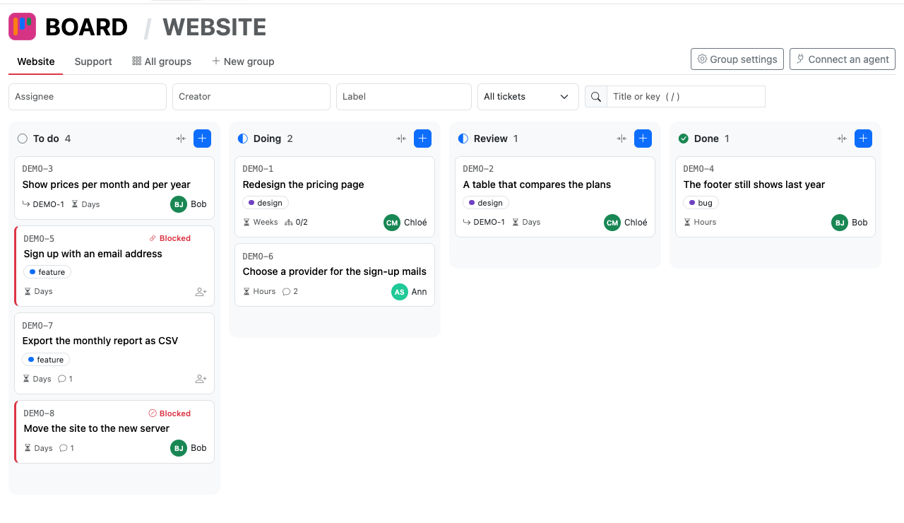
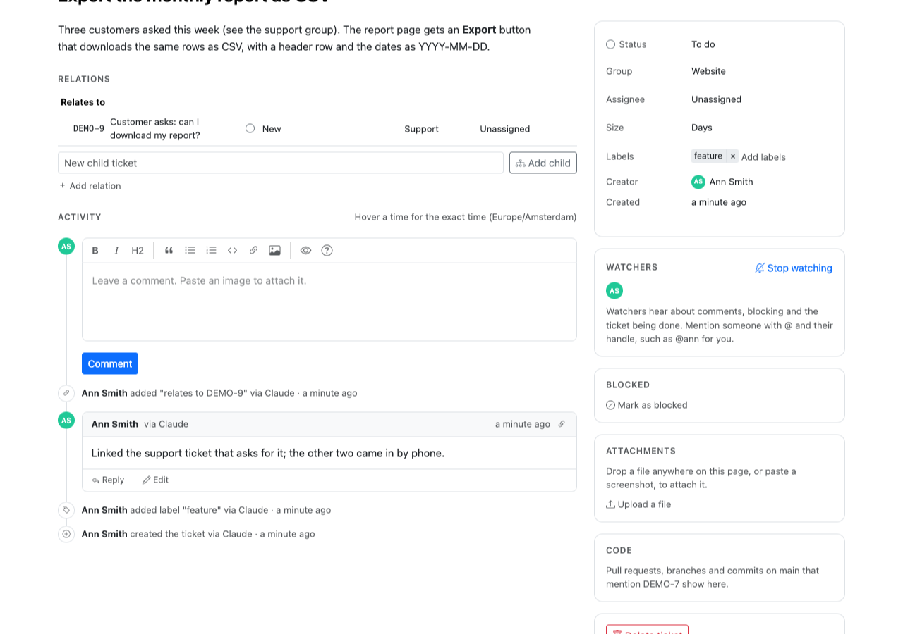
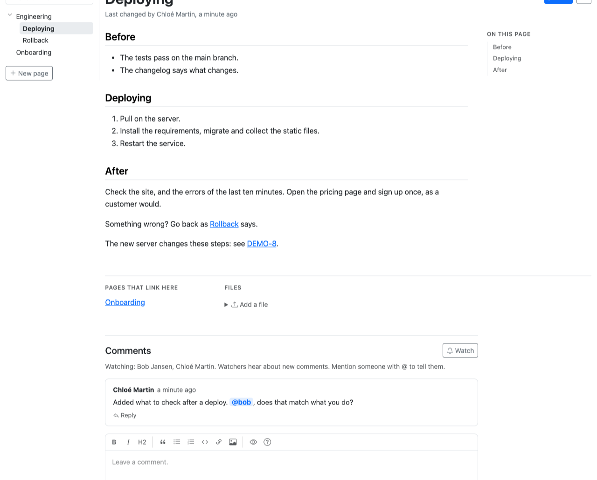

<p align="center">
  <picture>
    <source media="(prefers-color-scheme: dark)" srcset="brand/dg-mark-dark.svg">
    
  </picture>
</p>

# DataGroceries

Open-source Django apps that people and AI agents work on together. Each app installs on its own into a
Django project you already have, with its own login and its own users, and agents reach all of them
through one MCP endpoint.

The apps are **the board**, a kanban ticket tracker, and **the wiki**, the team's own knowledge next to
it.

**Try it** at [demo.datagroceries.com](https://demo.datagroceries.com): an account with one click, a small
team's board and wiki, and Claude connected in a minute. It starts again every night.



## What the board does

- **A kanban board** with drag and drop, groups per team or project, each with its own columns, and
  filters on assignee, creator, label and text.
- **Tickets** with a Markdown description, labels, a size, comments with replies, and screenshots
  dropped or pasted onto the page. Parents and subtasks, blockers, duplicates and related tickets.
- **History**: every change to a ticket is kept, with who made it, and through which agent if one did.
  Each ticket shows it as one feed, with the comments and relations.
- **@-mentions and watchers**: people hear about what concerns them, by email, or any other way your
  project reaches them, such as Slack, with a notifier of its own.
- **Access per group**, as your project decides: who may read, comment, write or manage, on the pages
  and for agents alike.
- **GitHub**: a ticket links to the commits, branches and pull requests that mention its key.
- **In your project's language**: English and Dutch to start, the Django way, so another language is one
  more translation file.
- **A REST API and MCP tools** for working on tickets as on the pages: everything but deleting, uploading
  attachments, and making groups and columns.



## What the wiki does

- **Pages and folders in one tree**, as files and folders are: a folder's text is the index of the pages in
  it, and one name per folder. Addresses follow the tree, and a page renamed or moved keeps its old address
  leading to it. The wiki starts with its page `home`, an ordinary page.
- **Links between pages**, relative as in a browser, from the folder they are in (`[[Platform]]` beside a
  page or in a folder, `[[../Sales]]` a folder up), or from the top (`[[/Engineering/Deploying]]`, also in
  a ticket), that follow a page when it moves. A red link starts its page where it leads, with the folders
  it goes in. A page lists the pages that link to it, and a ticket the pages that name it.
- **History**: every version kept, with who made it and through which agent; two versions side by side,
  and an old one brought back.
- **Comments, @-mentions and watchers**, images and files, search, a page's versions in other languages,
  and pages downloaded as Markdown.
- **Access per page**, as your project decides: who may read, comment on or write a page, and the pages
  under it, on the pages and for agents alike.
- **A REST API and MCP tools** for everything the pages do but uploading and downloading files.



## What an agent does

An agent connected to the endpoint gets the tools of every app installed: 12 for the board (search, read,
create and update tickets, comment, relate, block, watch) and 14 for the wiki (search, read, write, move
and delete pages, their versions, comments, translations, watching). It works as the person who connected
it, so it is asked what you would ask a colleague:

- *"What is assigned to me, and what is blocked?"*
- *"Pick up DEMO-7: read it and the support ticket it relates to, and comment with a plan."*
- *"Write a wiki page on how we deploy, from DEMO-8 and its comments, and link it from the ticket."*
- *"Translate the Onboarding page into Dutch."*

Its changes notify the same people a person's would, and the history shows them as that person's, via
the agent.

## Why DataGroceries

- **It fits into your Django project.** A few lines in your settings and one URL include. Your login,
  your user model and your database stay as they are. `manage.py check` tells you what is still
  missing.
- **Agents work as the people who connect them.** An agent reaches only what its person may use, and
  every change it makes says so in the history. No accounts for agents, no shared keys.
- **Connecting an agent is easy.** Any MCP client connects with a personal token. Claude (claude.ai,
  Claude Desktop, Claude Code) and VS Code need only the endpoint's address and a sign-in with your own
  login.
  Projects with API logins of their own (DRF tokens, JWT, an OAuth server) can let those in instead.
- **Yours.** MIT licensed, no service to sign up for, and the data stays in your own database. The
  pages bring their own layout and assets, so they work behind a firewall and load nothing from
  elsewhere.

DataGroceries is for teams that build on Django, want their tracker and their wiki inside their own project, and
work with AI agents.

## What it does not do

Each app does a few things one way, on purpose, so some things are left out:

- **It is not a service to sign up for.** It runs in a Django project: one you already have, or a small
  one of its own when you want only the board and the wiki. DataGroceries' own instance is such a project,
  a settings file and a URL include ([deploy/web1](deploy/web1/)).
- **No sprints, estimates in points, due dates, priorities or time tracking**, and no custom fields: a
  ticket's fields are fixed in code. A size (hours, days, weeks) and labels are what there is.
- **No access screens of its own.** Whoever may use the board or the wiki may do everything in it, unless
  your project says otherwise, per group of the board or per page of the wiki, in one method of your own:
  read, comment, write or manage
  ([integrating.md](docs/integrating.md#per-group-of-the-board-per-page-of-the-wiki)).
- **No live updates.** A page shows what was there when it loaded. In the wiki, a save made on top of
  someone else's is refused, naming them, rather than merged.
- **English and Dutch only**, for now; another language is one more translation file.
- **Notifications by email, out of the box.** Slack, Teams or anything else is a notifier of your own,
  a few lines ([integrating.md](docs/integrating.md#notifications)). Nothing comes in by email.

## Design principles

- **Django first.** What Django has, DataGroceries uses, rather than a library or code of its own: its users
  and your user model, groups and permissions for who may use what, the admin, the ORM and migrations on
  any database Django supports, its email settings, its task framework for sending notifications (so
  you choose the worker, and no Celery or Redis is needed), its translation machinery for the pages'
  languages, forms, messages and system checks. Whoever
  knows Django already knows how to run DataGroceries.
- **A good default, and room to integrate fully.** Whatever your project already has its own way, such
  as its people and their accounts, its sign-in, its permissions, its languages, your agents' ways in,
  how people hear about things and its layout, DataGroceries does well out of the box, and your project
  can always take it over entirely. So the apps become part of your project rather than sit beside it: one
  account, one sign-in, the same language everywhere.
- **Opinionated.** Each thing works one way, chosen once and the same for everyone, so there is less to
  learn, configure and keep working. Settings exist only to fit DataGroceries into your project, such as who
  your people are or where notifications go, never to have a feature another way.
- **Agents are first-class users.** What a page can do, an MCP tool can do too, through the same code
  and under the same rules. A tool runs the app's own REST view, so the pages, the API and the agents
  can never drift apart.
- **Each app installs on its own.** Apps depend on core only, never on each other, and work together
  through core when both are installed.

## Packages

| Package | |
|---|---|
| [`django-dg-board`](packages/django-dg-board/) | The kanban ticket tracker. |
| [`django-dg-connect`](packages/django-dg-connect/) | Connecting agents: personal tokens, OAuth so Claude connects with the endpoint's address alone, and a "Connect an agent" page. Not needed if your project's own API logins are enough for your agents. |
| [`django-dg-wiki`](packages/django-dg-wiki/) | The wiki: pages in Markdown, in one tree. |
| [`django-dg-core`](packages/django-dg-core/) | What the apps share: the one MCP endpoint, people, notifications, and the checks on every way in. Comes with every app. |

Django 5.2 LTS and 6.x, Python 3.11 and newer, any database Django supports.

## Getting started

```bash
pip install django-dg-board django-dg-connect
```

```python
INSTALLED_APPS = [
    ...,
    'django.contrib.humanize',
    'rest_framework',
    'simple_history',
    'oauth2_provider',
    'datagroceries.core',
    'datagroceries.connect',
    'datagroceries.board',
]
```

```python
urlpatterns = [..., path('dg/', include('datagroceries.urls'))]
```

Then `manage.py migrate`, give a group the permission "Can use the board", and open `/dg/board/`.
[docs/integrating.md](docs/integrating.md) is the full guide: your own users, your own layout, your own API
logins, notifications, and moving your tickets over from another tracker.

## Status

Young, and used for its own development: DataGroceries' own tickets are on a DataGroceries board, which people and
agents work on together. What was decided and why is in [docs/decisions.md](docs/decisions.md). More apps
may follow, such as a CMS and a helpdesk.

## Contact and contributing

Questions are welcome in [GitHub Discussions](https://github.com/datagroceries/django-dg/discussions), bugs and
wishes in [GitHub issues](https://github.com/datagroceries/django-dg/issues). A security problem goes privately
through GitHub, as [SECURITY.md](SECURITY.md) says. To work on DataGroceries itself, start with
[CONTRIBUTING.md](CONTRIBUTING.md).

## Thanks to Eddy Grid

The board started as Eddy Board, the ticket tracker [Eddy Grid](https://eddygrid.com) built for its own team.
Eddy Grid kindly agreed to its release as open source, so it can be yours too.

## Licence

MIT, see [LICENSE](LICENSE).
