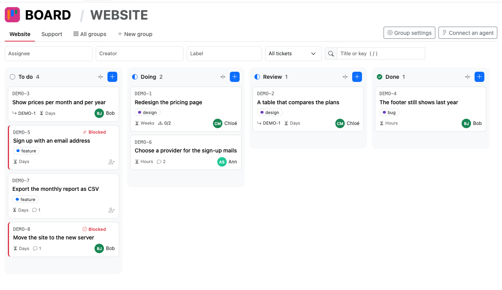
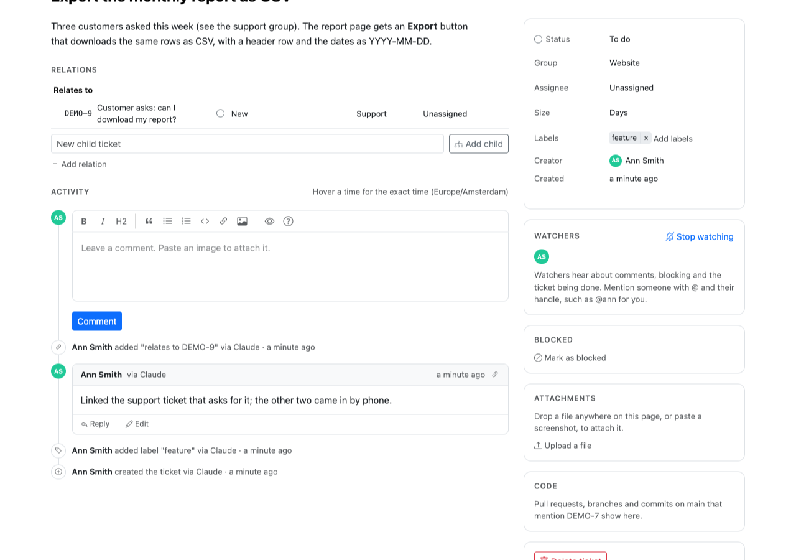

# django-dg-board

A kanban ticket tracker for a Django project, that people and AI agents work on together. Part of
[DataGroceries](https://github.com/datagroceries/django-dg). It started as Eddy Board, the tracker
[Eddy Grid](https://eddygrid.com) built for its own team, which kindly agreed to its release, and keeps its
design.

**Missing something?** A [feature request](https://github.com/datagroceries/django-dg/issues/new?labels=enhancement)
or a word in [Discussions](https://github.com/datagroceries/django-dg/discussions) is very welcome: we
would rather build what people use, so feature requests come high on our list.

## What it does

- A kanban board with drag and drop, groups per team or project with their own columns, and filters on
  assignee, creator, label, text, and a ticket with everything under it.
- Tickets with a Markdown description, labels, a size, comments with one level of replies, and
  attachments dropped or pasted onto the page; parents and subtasks, blockers, duplicates and related
  tickets.
- Every change kept, with who made it and through which agent, shown per ticket as one activity feed.
- @-mentions and watchers, told by email, or any way the project's own notifier reaches them.
- Links to the GitHub commits, branches and pull requests that mention a ticket.
- A REST API and MCP tools, so an agent works on tickets as the person who connected it.
- English and Dutch, following the project's language.

Try it at [demo.datagroceries.com](https://demo.datagroceries.com): an account with one click, and Claude
connected in a minute.





How the board is built, its requirements and its principles are in
[docs/board.md](https://github.com/datagroceries/django-dg/blob/main/docs/board.md).

## Installing

The full guide, for a project that already has its own logins, users, API tokens or front end, is
[docs/integrating.md](https://github.com/datagroceries/django-dg/blob/main/docs/integrating.md). In short:

```python
INSTALLED_APPS = [
    ...,
    'django.contrib.humanize',
    'rest_framework',
    'simple_history',
    'datagroceries.core',
    'datagroceries.board',
]
```

```python
urlpatterns = [
    ...,
    path('dg/', include('datagroceries.urls')),  # every DataGroceries app and the MCP endpoint
]
```

Then `manage.py migrate`, and `manage.py check`, which says what is still missing, such as who may use
the board. The pages bring their own layout, `dg_core/base.html`, so they work whatever
the project's front end is. To show them inside the project's own layout instead, override that template,
as with Django's admin: it says what it must keep.

Who may use the board is a Django permission, "Can use the board" (`dg_board.use`): grant it to a
group in the admin, and put people in that group. Superusers have it. Those who have it are the board's
people: they can be assigned and @-mentioned. Each one's @-handle is their username by default. A
project that sees its people differently, such as by a nickname, a photo or rules of its own, names a
subclass of `datagroceries.core.people.People` in `DG_PEOPLE`; that module says how.

What someone may do in each group is the same class's `may(user, right, group)`: `read`, `comment`,
`write` or `manage`, each including the ones before it. By default everyone who may use the board may do
everything; a project that wants less overrides `may`. Every page, API call and MCP tool asks it, through
`access.py`, so an agent never does more than its person may.

**Settings.** `DG_BOARD_NAME`, `DG_BOARD_KEY_PREFIX` and `DG_BOARD_COLORS`, each with a default
(`conf.py`), and the GitHub settings below. Avatars are an image when the project's `People` gives one, and initials otherwise (`datagroceries.core.people`).

**Times** are in Django's current timezone, as on the project's own pages: `TIME_ZONE`, or each
person's own when the project activates it.

**Languages.** English and Dutch, following the project's language (`django.utils.translation`); the
JavaScript's texts through Django's JavaScript catalog (`dg/jsi18n/`). The API and the MCP tools stay
English.

**Front end.** Bootstrap 5.3.8, Bootstrap Icons 1.13.1 and the Markdown editor (EasyMDE 2.21.0)
from core, plus htmx 1.9.8, SortableJS 1.15.7 (drag and drop) and Tom Select 2.6.2 (searchable and
multi-selects). All ship in the packages (`static/*/vendor/`, each with its licence), not from a CDN, so
the pages work offline, on an internal network and under a strict Content Security Policy, and no third
party sees who visits them. Form fields get their
Bootstrap layout from the board's own `field` tag, so the project needs no form package. Markdown is rendered
by core (`datagroceries.core.markdown`), as in every DataGroceries app; the board adds its ticket keys and @-mentions to it
(`ticket_links.py`), so they show in the other apps' Markdown too.

## Notifications

- A ticket's `Watcher`s hear about it: comments (with the text quoted), the ticket being blocked or
  unblocked (with the reason) and its entering a done column. A new assignee and anyone @-mentioned in a
  comment or the description hear about that too. A message about a comment links straight to it
  (`#comment-12`), and so does a comment's own 🔗 on the page.
- Creator, assignee, commenters and @-mentioned people start watching on their own; anyone can switch
  it on or off on the ticket page.
- `@jasper` mentions the person whose handle is `jasper`. In every Markdown editor,
  `@` and the start of a handle, first or last name lists the people it may mean, and a pick fills in
  the handle that reaches them (core's `editor.js`, from the board's `mention_people` tag); not inside code. While it is
  written, each `@handle` that reaches someone is marked, so a typo shows before saving.
- Nobody hears about their own change. Only the views notify (`notifications.py`), never a model
  signal, so bulk changes stay quiet.
- A message goes out once the change is committed, through `datagroceries.core.notifications`: by email, or as the
  project's own notifier does it (`DG_NOTIFIER`).

## API for agents

An agent reads and writes tickets through `dg/board/api/tickets/` as the person it works for, with a
connected app or a personal token (django-dg-connect, at `dg/connect/`), or through the board's tools on the one MCP endpoint, `dg/mcp`.
The token goes as `Authorization: Bearer dg_…`, or as `Token dg_…` as with DRF's own tokens. A
project with ways in of its own (its own tokens, JWT, anything DRF can check) lists their classes in
`DG_AUTHENTICATION_CLASSES`, so its people need no second token; a key without the `dg_` prefix is
left to them. A project with its own OAuth server names it in `DG_AUTHORIZATION_SERVER`, and the MCP
endpoint's 401 then points MCP clients there (`datagroceries.core.authentication`). The views are in `api.py` and
the tools, which run those views, in `mcp.py`.

- Whatever lets a request in, it reaches the board's area (`board`) only while its person may use the
  board, and only if the token's scopes, when it has them, cover it. Checked on every request.
- People are named by their handle, with their email address beside it when they have one; an assignee
  may be given as either.
- Changes go through `operations.py` and the pages' forms, notifications included. Their history
  records carry `via <token name>`, `via <OAuth app>` or `via API` as change reason, which the activity
  feed shows.
- Editing a comment works as on the page: only its author may, and only people it newly @-mentions
  hear about it.
- Not in the API: deleting tickets or groups, uploading attachments, and making groups and columns.

## GitHub

Code in the repository (`DG_BOARD_GITHUB_REPOSITORY`) that mentions a ticket's key is linked to it, as a
`CodeReference`, and listed in a Code panel on the ticket page (pull requests first, then branches, then
commits) and under `code` in the ticket API. `github.py` does the work:

- **Commits** on the default branch count by the keys in their message, which on `main` is the squashed
  pull request.
- **Branches** count by the keys in their name, in any case (`anna/t-123-invoices`). A branch stands
  in for its work until a pull request is opened from it, which then replaces it on the ticket, so
  merged-and-deleted branches do not pile up.
- **Pull requests** count by the keys in their title and their branch's name, not their description,
  which names other tickets in passing. The state follows the pull request (open, merged, closed, in
  the colours of the column categories), and a key taken out of the title takes its link away.
- A key that names no ticket is ignored.
- **Deliberately not:** a merged pull request does not move its ticket to done. The link and its state
  show on the ticket; moving it stays with people.

**The webhook** at `dg/board/github/webhook/` takes GitHub's `push`, `pull_request` and `create` events.
It needs no login, and proves the sender by the `X-Hub-Signature-256` signature instead, made with
`DG_BOARD_GITHUB_WEBHOOK_SECRET`. Other repositories, pushes to other branches, tags and other events
link nothing.

**The backfill**, `manage.py backfill_github [--since 2025-03-01]`, reads the default branch's commits
and every pull request from the GitHub API with `DG_BOARD_GITHUB_TOKEN`, 100 a request, and is safe to run
again. Branches are left to the webhook: GitHub keeps no record of who made one when, and a branch that
got a pull request is represented by it anyway.

**Setting it up**, once:

1. `DG_BOARD_GITHUB_REPOSITORY` (`owner/name`), a fine-grained GitHub token for the repository with
   read-only Contents, Pull requests and Metadata as `DG_BOARD_GITHUB_TOKEN`, and a long random
   `DG_BOARD_GITHUB_WEBHOOK_SECRET`. While the secret is empty the webhook refuses every delivery,
   and without the token the backfill stops.
2. A webhook in the repository's settings: payload URL `https://<your site>/dg/board/github/webhook/`,
   content type `application/json`, the same secret, and the individual events Pushes, Pull requests
   and Branch or tag creation. GitHub's first delivery is a ping, which should answer 200.
3. `manage.py backfill_github`.
