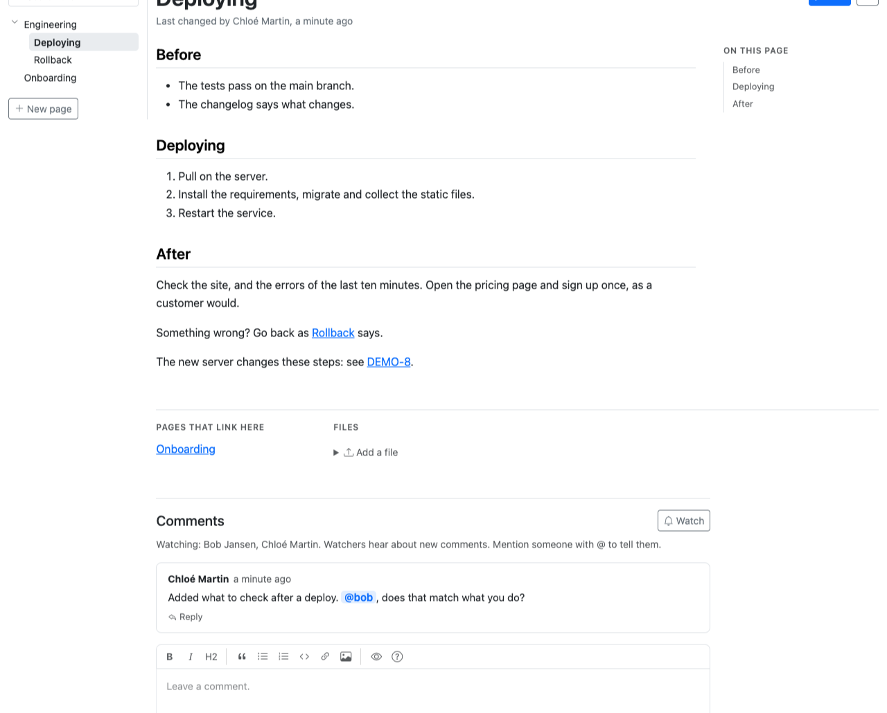

# django-dg-wiki

A wiki for a Django project, that people and AI agents write together, next to the board. Part of
[DataGroceries](https://github.com/datagroceries/django-dg).

## What it does

- Pages in Markdown, in one tree of pages and folders, as files and folders are: a folder's text is the
  index of the pages in it, and a page becomes a folder, or back, when someone says so. One name per
  folder. Addresses follow the tree (`dg/wiki/engineering/` for a folder, `dg/wiki/engineering/deploying`
  for a page), and a page renamed or moved keeps its old address leading to it. Pages are put in order,
  or in a folder, by dragging them in the tree.
- The wiki starts with its page `home` at the top, an ordinary page, as a site's `/` shows its
  `index.html`.
- Links between pages, as relative addresses in a browser, from the folder they are in: `[[Platform]]` is
  the page beside a page, or in a folder, `[[../Sales]]` one folder up, and `[[/Engineering/Deploying]]` is
  from the top, also from a ticket's text. A red link starts its page where it leads, with the folders it
  goes in. A page lists the pages that link to it, and the links follow when a page is renamed or moved.
- The Markdown editor of every DataGroceries app, and a table of contents beside a long page.
- Every save kept, with who made it and through which agent; two versions compared side by side, and an
  earlier one brought back. A save is refused when someone else saved the page in the meantime.
- Images in the text, pasted or dropped into the editor, and files beside a page.
- Comments and replies, with @-mentions; the people watching a page hear about new comments.
- Search through every page's title and text, and pages downloaded as Markdown: one page as a file, or
  a page with all under it, or the whole wiki, as a zip with their images, the links between them kept.
- A page in several languages: each version beside it, new or linked from a page already there, and told
  when the page it translates changed after it. The tree shows a page's language.
- Access per page, as the project decides: who may read, comment on or write a page and the pages under
  it, in one method of the project's own (`People.may`), on the pages and for agents alike. By default
  everyone who may use the wiki may do everything.
- A REST API and MCP tools for everything the pages do but uploading and downloading files, and on a
  ticket, while the board is installed too, the wiki pages that name it.
- English and Dutch, following the project's language.

Try it at [demo.datagroceries.com](https://demo.datagroceries.com): an account with one click, and Claude
connected in a minute.

## Installing

As every DataGroceries app, described in
[docs/integrating.md](https://github.com/datagroceries/django-dg/blob/main/docs/integrating.md): add `'datagroceries.wiki'`
to `INSTALLED_APPS` after `'datagroceries.core'`, run `manage.py migrate`, and grant the permission "Can use the
wiki" (`dg_wiki.use`) to a group. The pages are at `dg/wiki/`.

MIT licensed.
